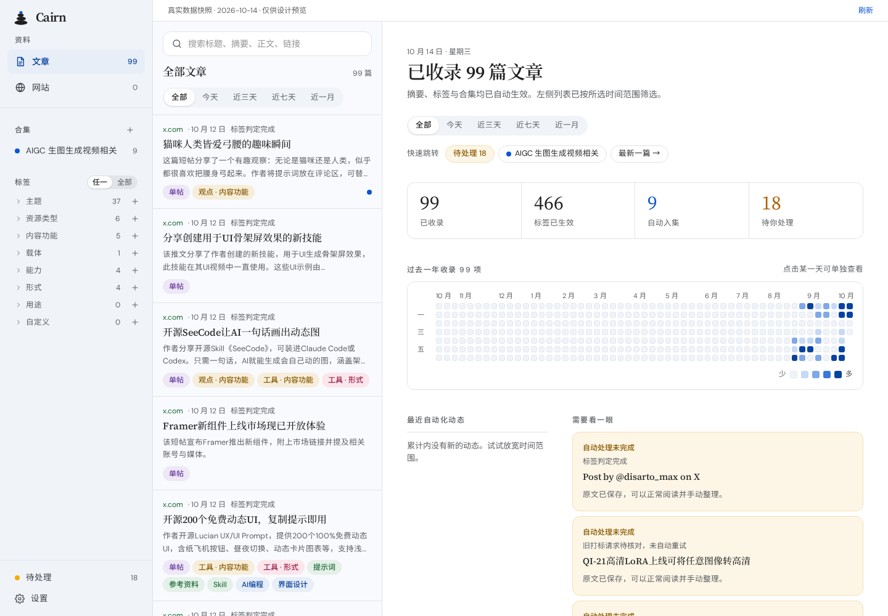

# 设计基线

本页记录最初迁移的历史基线。Alpenl/UI 当前展示版本已按用户要求同步到 2026-10-14 的上线界面，来源、数据和静态边界见 [design-sync.md](design-sync.md)。下文零差异结果仅适用于最初迁移，不适用于本次更新；页面底部预览图已更新为当前设计。

权威来源：[alpen-yy/newUI](https://github.com/alpen-yy/newUI/tree/74746901283006639dd2e815d16b151beb626803)。初始迁移固定提交 `74746901283006639dd2e815d16b151beb626803`，后续设计更新需要显式升级基线。

采用其 React 源码和 CSS 作为迁移依据，保留类名、布局、图标路径、文案和交互结构。拆分组件不作为重新设计界面的理由。

## 首版检查

- 在同一 Chromium、1440×1000 视口、中文环境对照原稿与新工程。
- 对照文章概览、文章阅读、网站列表；进一步检查站点详情、合集管理、标签管理和 390×844 窄屏。
- 设置页新增界面语言选择，属于本次明确需求；其他原有区域保持其视觉样式。
- 字体使用原稿 Google Fonts 的原始文件，在本工程中自托管加载，检查时等待 `document.fonts.ready` 和入场动画结束。
- 自动浏览器测试覆盖固定侧栏宽度、语言切换后的页面、阅读状态恢复、管理编辑与窄屏无横向溢出。

## 更新流程

1. 固定新设计提交并记录变化。
2. 优先修改对应组件及令牌，不覆盖整个模板。
3. 运行类型、lint、单元测试、构建、浏览器测试。
4. 在同视口和字体条件下重新对照截图。中英文分别检查，保留用户内容原文。

`tests/e2e` 检查行为与关键布局，不能替代所有页面的人工视觉审阅。截图及对照结果由本次验收产生，不把生成后的界面误当成原稿基线。

## 可复现的截图对照

本次最终检查：上述 7 个场景在同一 Chromium 条件下，Pixelmatch（threshold 0.1，忽略抗锯齿）均报告 **0 个差异像素**。这是固定视口与字体环境下的对照结果，不代表所有设备的绝对像素一致。

仓库内提供 `scripts/compare-design.mjs`。分别启动固定提交的设计稿和本工程后执行：

```sh
REFERENCE_URL=http://127.0.0.1:5186 APP_URL=http://127.0.0.1:5175 pnpm test:design
```

脚本在截图时结束双方的有限入场动画，避免分批卡片的动画帧差异。脚本输出原稿、新实现、差异图及 `report.json` 到忽略提交的 `test-results/design/`；差异超过 0.1% 返回失败。不要把新实现的截图作为参考输入。原稿带 Figma 专用 Vite 配置，在本地独立预览时只需 React/Tailwind 插件，不需要修改原稿的界面源码。


